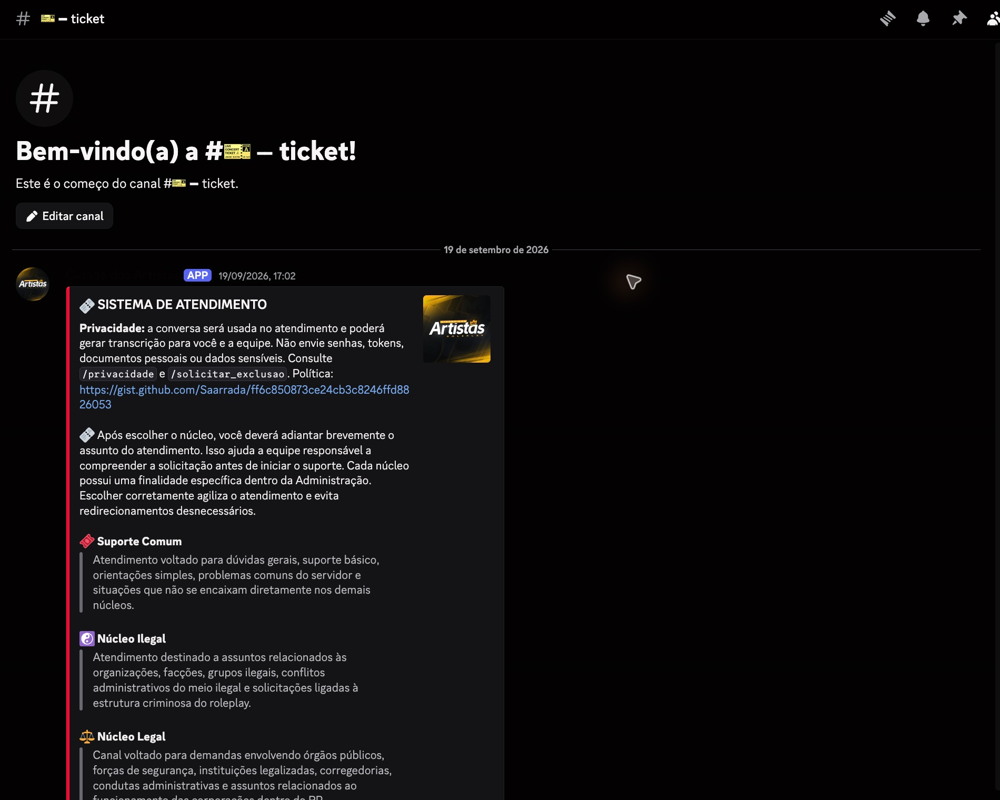
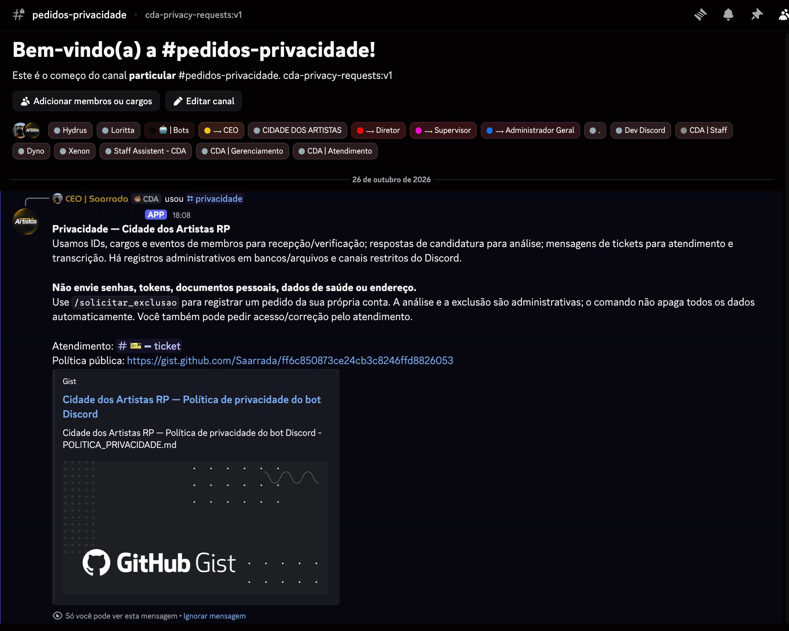

# Cidade dos Artistas — evidências para revisão do Discord

Aplicativo: `1550917857439645756`. Capturas reais de 26/10/2026.

## Atendimento atual

Painel atualizado pelo aplicativo atual, com aviso de privacidade e encaminhamento de atendimento. Esta imagem demonstra a interface; não demonstra leitura de conteúdo ou geração de transcrição com MESSAGE_CONTENT.

## Privacidade atual

Resposta real e efêmera do comando /privacidade, incluindo política pública, contato e procedimento administrativo de exclusão. O comando não promete exclusão automática.

## Limites da demonstração

A consulta à API do aplicativo não indicou autorização para GUILD_MEMBERS nem MESSAGE_CONTENT. Essas intenções permanecem desativadas na configuração atual. Não há nesta evidência demonstração de evento de entrada de membro ou transcrição com conteúdo comum de mensagens. Mensagens históricas do bot anterior foram excluídas deste pacote para não atribuí-las ao aplicativo atual.

O BitLocker foi instalado no dedicado, mas a reinicialização e a ativação da criptografia aguardam janela de manutenção. Não declaramos criptografia em repouso ativa.

[Política pública](https://gist.github.com/Saarrada/ff6c850873ce24cb3c8246ffd8826053)
